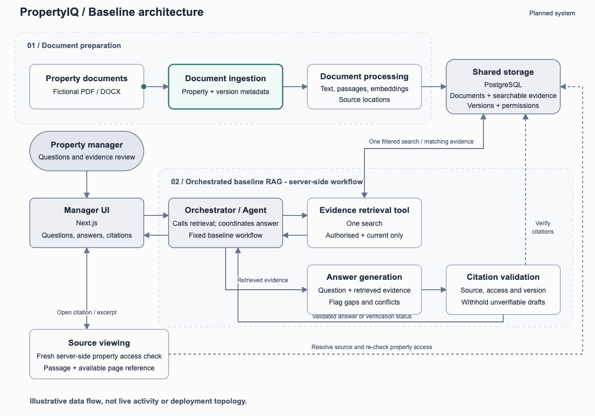

# PropertyIQ RAG

An **open-source prototype** for an internal property-management knowledge assistant. The planned application will let authorised property managers ask natural-language questions about property documents and inspect the evidence behind answers.

> **Status:** Requirements and repository scaffold only. The application, benchmarks, and user interface have not been implemented yet.

## Business use case

A property management business handles residential and commercial properties. Staff frequently need to consult tenancy agreements, maintenance policies, contractor agreements, inspection reports, and tenant handbooks to answer questions and resolve discrepancies.

PropertyIQ aims to make this process faster while preserving source traceability, document currency, and access controls. Answers should cite the relevant evidence, explain conflicting information, and clearly indicate when the available documents cannot support a conclusion.

**Example question:**

> Who is responsible for repairing a leaking pipe in Apartment 204, and what is the required response time?

**Expected behaviour:** Retrieve the applicable tenancy agreement and maintenance policy, identify the responsible party and applicable response time (if documented), reference the supporting document and page, and explicitly flag conflicts or missing evidence. All demonstration documents will be fictional or appropriately licensed.

## Scope

**In scope (initial version)**
- Managing property documents (PDF and DOCX).
- Staff-only document Q&A with citations and supporting excerpts.
- Multiple-document answers, version handling, conflict detection, and abstention.
- Property-based access controls.
- Evaluation of answer quality, source reliability, and response times.

**Out of scope (initial version)**
- Tenant-facing access.
- Automated maintenance scheduling, supplier booking, or payments.
- Legal advice or automatic determination of disputed legal obligations.

## Requirements

See **[Business requirements](docs/requirements.md)** for the full numbered list, assumptions, and an example scenario.

## Architecture overview

**Planned baseline RAG architecture, not an implemented system.** PropertyIQ prepares property documents for search, then uses retrieved evidence to answer managers' questions.

Teal dots illustrate data moving through the planned workflow, not live activity. Solid arrows show the main flow; dotted arrows show lookups and checks. The baseline performs one search. These are logical responsibilities, not separate deployment units.

[Static diagram and editable SVG source](docs/assets/architecture.svg)

- **Prepare documents:** Ingestion and processing build searchable evidence with property, version and source metadata.
- **Answer questions:** The UI calls the orchestrator, which invokes the retrieval tool once, coordinates generation and citation validation, then returns the result.
- **Inspect evidence:** Opening a citation triggers a fresh server-side property-access check.

The comparison variant, **agentic RAG**, keeps the same components and allows at most one targeted follow-up search. See [the detailed design](docs/design.md) for strategy flows and quality, latency and cost evaluation.

## Development and portfolio evidence

As development progresses, this repository will include source code, synthetic sample documents, test questions, measured evaluation results, setup instructions, and architecture decisions. Any reported metrics will be reproducible and explicitly distinguish demonstration results from production claims.

## Data and security

Do not commit client documents, personal data, secrets, or credentials. Synthetic demonstration documents may be checked in under a dedicated sample-data directory once created.
