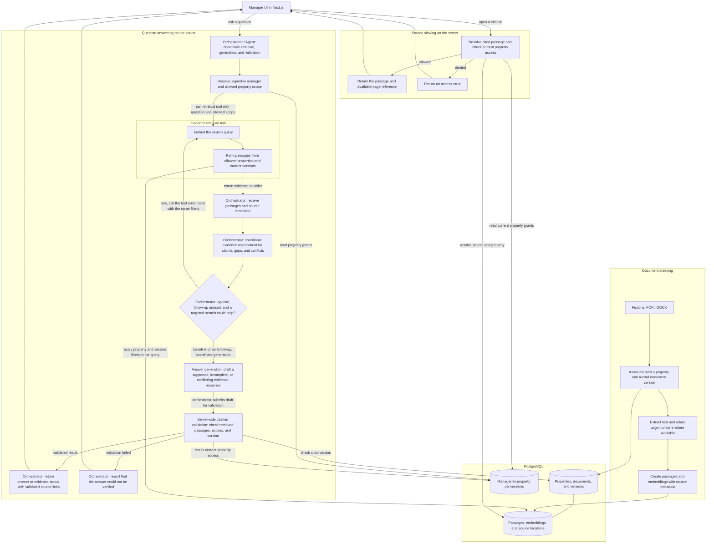
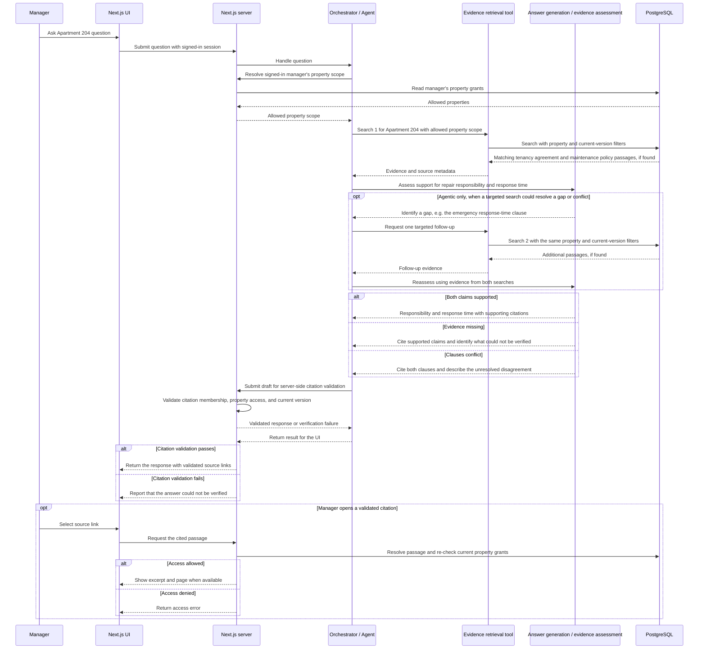

# PropertyIQ — Baseline Architecture

**Status:** Baseline RAG design for the manager-only experiment.

## Architecture

See the [repository architecture overview](../README.md#architecture-overview) for the high-level component flow. The diagram below expands the server checks and strategy comparison.

The manager-only experiment shares three paths across both RAG strategies: document indexing, question answering, and source viewing. The strategy controls whether the question flow can make a second search.

The UI calls a server-side orchestrator, not the retrieval tool directly. Baseline orchestration follows a fixed sequence with one retrieval call; agentic orchestration may request one targeted follow-up. The retrieval tool enforces property access and current-version filters regardless of strategy.

## Components

| Component | Responsibility |
|---|---|
| Document ingestion | Accepts PDF/DOCX, identifies the property, and creates a document/version record. |
| Document processing | Extracts text, preserves page boundaries, creates passages, generates embeddings, and links each passage to its source. |
| Storage | Stores property permissions, documents, versions, passages, embeddings, and answer metadata. |
| Orchestrator / Agent | Receives UI questions, calls retrieval, coordinates generation and server-side citation validation, and returns the result. The baseline follows a fixed one-search workflow. |
| Evidence retrieval tool | Embeds the query and retrieves passages, enforcing property permissions and current-version filters on the server. |
| Answer generation | Uses the question and retrieved evidence to draft a cited response, flagging unsupported claims and conflicts. |
| Citation validation | Checks citation membership, current property access, and document version; withholds unverifiable drafts. |
| Next.js UI | Accepts manager questions, displays the answer and citations, and opens supporting passages. |

### Orchestration Strategies

| Strategy | Orchestrator behavior | Retrieval limit |
|---|---|---|
| Baseline RAG | Fixed sequence: retrieve, generate, validate, return. No autonomous tool selection or follow-up. | Exactly one search per question |
| Agentic RAG | Assess the initial evidence and decide whether one targeted follow-up would help, then generate, validate, and return. | One initial search and at most one follow-up |

Both strategies use the same retrieval tool and server-enforced controls. The orchestrator cannot expand property access or bypass current-version filtering.

## Baseline Retrieval Flow

1. The manager asks a question in Next.js. The UI sends it to the server-side orchestrator, which resolves property permissions using the signed-in manager's identity.
2. The orchestrator calls the evidence retrieval tool once. The tool queries PostgreSQL with allowed-property and current-version filters, then returns ranked passages and source metadata to the orchestrator.
3. The orchestrator coordinates answer generation from the retrieved evidence, identifying any unsupported claims or conflicting clauses.
4. The orchestrator submits the draft for server-side citation validation. Every citation must point to an authorized, current passage in the retrieved set. The orchestrator returns the validated response to the UI; if validation fails, it returns an explicit verification failure instead of the draft.
5. Opening a citation triggers a separate server request that checks current property access before showing the passage.

## Example: Apartment 204

Question: **Who is responsible for repairing the leaking pipe in Apartment 204, and what is the required response time?**

- **Evidence found:** Answer the responsibility and response-time claims, citing both applicable documents where available.
- **Evidence missing:** Say that the available documents do not support a complete answer.
- **Evidence conflicts:** Show both clauses, identify the disagreement, and do not select one as fact without a current, authoritative resolution.

## Server Enforcement

Server-side controls—not UI state or model-generated tool arguments—must enforce:

| Control | Enforcement point |
|---|---|
| Property access | Before retrieval and before any source/document is opened |
| Current-version filtering | Before retrieval; superseded passages are excluded |
| Citation validation | Before returning an answer; citations must map to retrieved, authorized evidence |
| Source access | Re-check property permission when opening a passage or document |

## Fixed Across Both Strategies

- Fictional PDF/DOCX ingestion
- Document processing and passage metadata
- PostgreSQL storage and retrieval
- Orchestrator, evidence retrieval tool, answer generation, and citation validation responsibilities
- Property access control
- Current-document filtering
- Citation format and validation
- Missing-evidence and conflict behavior
- Next.js answer and source UI

The agentic variant keeps these components fixed and adds at most one optional targeted follow-up search after the baseline search.

## Architecture Decision

Compare baseline and agentic RAG using a known evaluation set:

- **Answer quality:** correctness, citation quality, completeness, conflict handling
- **Latency:** time from question submission to displayed answer
- **Cost:** model and retrieval cost per question

The baseline should remain the default while it meets the agreed quality threshold and offers the lower latency/cost. The agentic variant is justified only if an additional targeted search measurably improves answer quality.
